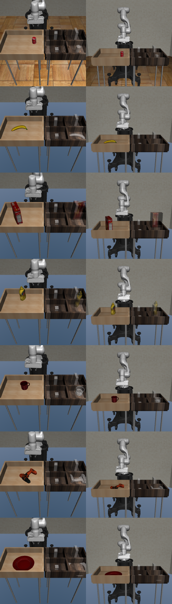

# robosuite YCB

## This repo adds the YCB asset suite to robosuite. This is useful for testing your manipulation algorithms for their ability to generalize across various objects.

## Setup

```bash
pip install -e .
```

Ships YCB assets with scripts to generate the required raw files. 

The raw mesh for a given `ycb_id` downloads automatically (needs internet) into `models/assets/objects/ycb/raw/`.

## Choosing the object in Lift

```python
import robosuite as suite
from robosuite.environments.manipulation.lift import YCB_OBJECTS

env = suite.make("Lift", robots="Panda", object_type="011_banana")  # YCB id (or "ycb:011_banana")
env = suite.make("Lift", robots="Panda", object_type="cylinder")    # box | cylinder | capsule | ball
env = suite.make("Lift", robots="Panda", object_type="bottle")      # bottle | can | lemon | milk | bread | cereal

print(YCB_OBJECTS)  # YCB ids that load cleanly
```

## Choosing the object in PickPlaceCan

`object_type` takes anything Lift's does and swaps it in for the can:

```python
import robosuite as suite

env = suite.make("PickPlaceCan", robots="Panda")                            # default can
env = suite.make("PickPlaceCan", robots="Panda", object_type="011_banana")  # YCB id (or "ycb:011_banana")
env = suite.make("PickPlaceCan", robots="Panda", object_type="lemon")       # primitive or XML object
```

- The new object keeps the can's name (`Can`). Its observations (`Can_pos`, `Can_quat`, ...), target bin and success check are therefore the can's, and Can-trained policies run without changes.
- A YCB object's target marker is a see-through gray copy of the object. Other objects keep the can marker.
- Only the active object is placed in bin 1. This lets large objects such as `003_cracker_box` and `029_plate` fit. Milk, bread and cereal are still moved out of the scene on reset.
- `PickPlaceMilk`, `PickPlaceBread` and `PickPlaceCereal` accept `object_type` the same way and use that object's bin. On the base `PickPlace` env the argument is `object_model`, and it requires `single_object_mode=2`.



Regenerate the renders and run the checks with:

```bash
MUJOCO_GL=egl python tests/ycb/render_pick_place.py --objects 011_banana 025_mug   # -> renders/pick_place_ycb/
MUJOCO_GL=egl python tests/ycb/test_pick_place_ycb.py
```

## Camera images with YCB objects

mujoco_py draws YCB objects with their untextured meshes. When a YCB object is in the scene and `use_camera_obs=True`, Lift and PickPlace therefore render camera frames with the modern `mujoco` bindings and YCB's textured meshes (`robosuite/utils/ycb_textured_renderer.py`), while physics stays on mujoco_py. 